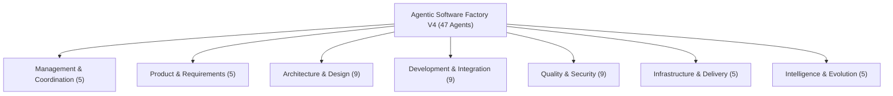

# Specialized Multi-Agent Intelligence — Agent Catalogue (V4)

Agentic Software Factory V4 operates a modular ecosystem of 47 specialist agents grouped across 7 operational divisions. Every agent is strictly defined by an explicit JSON declaration conforming to `schemas/agent.schema.json`.

---

## Agent Division Taxonomy

---

## 1. Management and Coordination Division (5 Agents)

| Agent ID | Name | Role | Model Tier |
|---|---|---|---|
| `chief-orchestrator` | Chief Orchestrator Agent | Global Factory Orchestration and Lifecycle Governance | `tier_reasoning` |
| `project-manager` | Project Manager Agent | Milestone, Resource and Delivery Tracking | `tier_fast` |
| `task-planning` | Task Planning Agent | Task Decomposition and Dependency Graph Construction | `tier_reasoning` |
| `agent-coordination` | Agent Coordination Agent | Task Dispatcher and Concurrency Arbiter | `tier_fast` |
| `workflow-manager` | Workflow Manager Agent | Workflow Pipeline Lifecycle and Transition Guardian | `tier_reasoning` |

## 2. Product and Requirements Division (5 Agents)

| Agent ID | Name | Role | Model Tier |
|---|---|---|---|
| `product-strategist` | Product Strategist Agent | Strategic Product Vision and Value Proposition | `tier_reasoning` |
| `business-analyst` | Business Analyst Agent | Business Process Modeling and Domain Analysis | `tier_reasoning` |
| `requirements-engineer` | Requirements Engineer Agent | Specification of Functional and Non-Functional Requirements | `tier_reasoning` |
| `prd-architect` | PRD Architect Agent | Product Requirements Document Authoring and Validation | `tier_reasoning` |
| `trd-architect` | TRD Architect Agent | Technical Requirements Document Authoring and Traceability | `tier_reasoning` |

## 3. Architecture and Engineering Division (9 Agents)

| Agent ID | Name | Role | Model Tier |
|---|---|---|---|
| `principal-software-architect` | Principal Software Architect Agent | System Architecture, Design Patterns and Governance | `tier_reasoning` |
| `project_designer` | Project Designer Agent | UI/UX Architecture, Design System & Graphic Design (100% Stitch / Figma MCP) | `tier_reasoning` |
| `backend-architect` | Backend Architect Agent | Backend Services and Business Logic Architecture | `tier_reasoning` |
| `frontend-architect` | Frontend Architect Agent | Web and Client-Side State Architecture | `tier_reasoning` |
| `mobile-architect` | Mobile Architect Agent | Cross-Platform and Native Mobile Architecture | `tier_reasoning` |
| `desktop-architect` | Desktop Architect Agent | Desktop Application Architecture (Electron, Tauri) | `tier_reasoning` |
| `database-architect` | Database Architect Agent | Data Modeling, Schema Design, and Query Optimization | `tier_reasoning` |
| `api-architect` | API Architect Agent | API Contract Engineering (REST, GraphQL, gRPC) | `tier_reasoning` |
| `ui-ux-designer` | UI/UX Designer Agent | Design Systems, User Journeys, and Accessibility Specs | `tier_reasoning` |

## 4. Development Division (9 Agents - Scoped strictly to `app/`)

| Agent ID | Name | Role | Model Tier |
|---|---|---|---|
| `frontend-developer` | Frontend Developer Agent | Web Client Component Implementation in `app/` | `tier_standard` |
| `backend-developer` | Backend Developer Agent | Server-Side Service and Business Logic in `app/` | `tier_standard` |
| `flutter-developer` | Flutter Developer Agent | Cross-Platform Mobile and Flutter Implementation in `app/` | `tier_standard` |
| `react-developer` | React Developer Agent | React & TypeScript Specialist Implementation in `app/` | `tier_standard` |
| `laravel-developer` | Laravel Developer Agent | Laravel & PHP Enterprise Development in `app/` | `tier_standard` |
| `nodejs-developer` | Node.js Developer Agent | Node.js & TypeScript Backend Engineering in `app/` | `tier_standard` |
| `desktop-developer` | Desktop Developer Agent | Native & Cross-Platform Desktop Development in `app/` | `tier_standard` |
| `database-engineer` | Database Engineer Agent | Database DDL Implementation, Migrations and Seeding in `app/` | `tier_standard` |
| `integration-engineer` | Integration Engineer Agent | Subsystem Binding, Third-Party SDKs, and End-to-End Wiring in `app/` | `tier_standard` |

## 5. Quality and Security Division (9 Agents)

| Agent ID | Name | Role | Model Tier |
|---|---|---|---|
| `qa-engineer` | QA Engineer Agent | Master Quality Assurance and Test Strategy Lead | `tier_reasoning` |
| `unit-testing` | Unit Testing Agent | Unit Test Suite Engineering and Mocking | `tier_standard` |
| `integration-testing` | Integration Testing Agent | Service Integration and API Contract Verification | `tier_standard` |
| `e2e-testing` | E2E Testing Agent | End-to-End User Journey Automation | `tier_standard` |
| `code-reviewer` | Code Reviewer Agent | Static Analysis, Code Quality, and Pattern Compliance | `tier_reasoning` |
| `security-architect` | Security Architect Agent | Threat Modeling, Security Architecture, and Crypto | `tier_reasoning` |
| `security-auditor` | Security Auditor Agent | Vulnerability Scanning, SAST, DAST, Secret Detection | `tier_reasoning` |
| `performance-engineer` | Performance Engineer Agent | Benchmarking, Profiling, Latency, and Memory | `tier_standard` |
| `accessibility-auditor` | Accessibility Auditor Agent | WCAG 2.1 AA/AAA Compliance Verification | `tier_fast` |

## 6. Infrastructure and Delivery Division (5 Agents)

| Agent ID | Name | Role | Model Tier |
|---|---|---|---|
| `devops-engineer` | DevOps Engineer Agent | Containerization, Infrastructure as Code, Provisioning | `tier_standard` |
| `cloud-architect` | Cloud Architect Agent | Cloud Architecture, Topology Design, Cost Estimation | `tier_reasoning` |
| `cicd-engineer` | CI/CD Engineer Agent | Continuous Integration and Deployment Automation | `tier_standard` |
| `release-manager` | Release Manager Agent | Release Packaging, SemVer, and Deployment Certification | `tier_reasoning` |
| `documentation-engineer` | Documentation Engineer Agent | Technical Documentation in `docs/` | `tier_fast` |

## 7. Intelligence and Evolution Division (5 Agents)

| Agent ID | Name | Role | Model Tier |
|---|---|---|---|
| `knowledge-manager` | Knowledge Manager Agent | Validated Knowledge Capture and Indexing | `tier_reasoning` |
| `memory-curator` | Memory Curator Agent | Memory Sanitization, Deduplication, Lifecycle Pruning | `tier_fast` |
| `learning-improvement` | Learning and Improvement Agent | Failure Post-Mortems, Skill Evolution, Lessons | `tier_reasoning` |
| `technical-research` | Technical Research Agent | Technology Feasibility, Library Evaluation, PoCs | `tier_reasoning` |
| `factory-auditor` | Factory Auditor Agent | Factory Self-Audit, Integrity, and Metrology | `tier_reasoning` |
