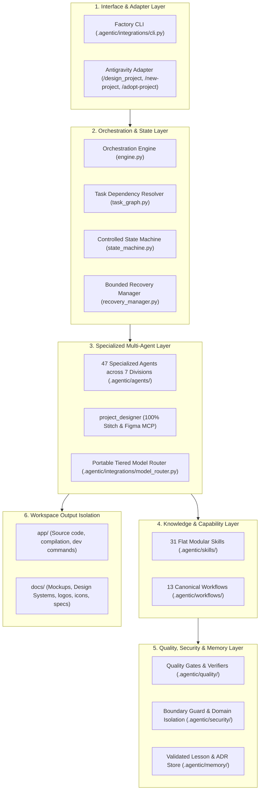

# Agentic Software Factory V4 — Core Architecture Specification

## 1. Architectural Philosophy

Agentic Software Factory V4 is built on the tenet that autonomous software development requires **formal systems engineering**, strict **domain isolation**, and **tool-native UI/UX design**, not unstructured conversational prompting.

### Key Architectural Tenets (V4):
1. **Strict Workspace Domain Isolation**:
   - `app/`: All application source code generation, developer agent implementations, compilation, and development commands are restricted exclusively to this directory.
   - `docs/`: All visual design mockups, Design Systems, Stitch MCP and Figma MCP outputs, logos, application icons, PRDs, TRDs, and documentation are restricted exclusively to this directory.
   - `.agentic/`: Single source of truth for all factory governance, schemas, agent contracts, modular flat skills, workflows, state machine, and validated memory.
2. **Dedicated Tool-Native Design Agent (`project_designer`)**:
   - Specializes in graphic design, Design Systems, application logos, and multi-resolution app icons.
   - Operates 100% through **Stitch MCP** (`StitchMCP`) or **Figma MCP** (`figma-dev-mode-mcp-server`) tools.
   - Triggered natively via the Antigravity command `/design_project`.
3. **Deterministic Task Graphs (DAG)**:
   - Development is decomposed into Directed Acyclic Graphs of discrete tasks where dependencies are resolved mathematically via Kahn's algorithm.
4. **Evidence-Based Completion & Bounded Recovery**:
   - No agent may declare a task `ACCEPTED` without attaching verifiable evidence.
   - Bounded recovery limits retries to 3 before escalating to human review, preventing infinite repair loops.
5. **Portable Model Routing Abstraction**:
   - Dynamic tier mapping (`tier_reasoning`, `tier_standard`, `tier_fast`) without hardcoded model IDs.

---

## 2. System Layers

---

## 3. Directory Structure Invariants

- `.agentic/agents/`: 47 explicit JSON agent definitions grouped by division, plus catalog.
- `.agentic/skills/<skill-name>/`: 31 strictly flat directories containing only root files (`SKILL.md` without subdirectories).
- `.agentic/workflows/`: 13 declarative JSON workflow pipelines specifying stages, modes, and gates.
- `app/`: All application source code and implementation.
- `docs/`: All mockups, wireframes, logos, icons, Design Systems, and documentation.
