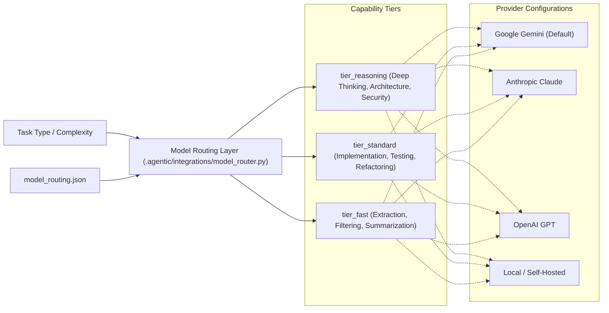

# Model Routing & Provider Abstraction Specification

## 1. Portability by Design

Agentic Software Factory V3 does not bind internal agent logic or orchestration to hard-coded foundation model identifiers. Instead, it defines a **Tier-Based Capability Abstraction**:



---

## 2. Model Tiers Definition

### 1. `tier_reasoning` (High-Complexity Reasoning)
* **Target Roles**: Chief Orchestrator, Principal Software Architect, Security Architect, Security Auditor, PRD Architect, Complex Root-Cause Debugger.
* **Characteristics**: Maximum reasoning depth, large context window (≥ 200k tokens), tool use, structured output adherence.
* **Provider Aliases**:
  - Gemini: `gemini-pro-reasoning` (e.g. Gemini 3.8 Pro / High Thinking)
  - Claude: `claude-tier-opus-reasoning` (e.g. Claude 3.7 / 3.5 Sonnet Thinking)
  - OpenAI: `gpt-tier-high-reasoning` (e.g. o3, o1, GPT-4.5)

### 2. `tier_standard` (Code Engineering & Testing)
* **Target Roles**: Frontend Developer, Backend Developer, Flutter Developer, React Developer, Unit Testing, Integration Testing, DevOps Engineer.
* **Characteristics**: Balanced latency, high code generation accuracy, multi-file context comprehension, deterministic lint and syntax compliance.
* **Provider Aliases**:
  - Gemini: `gemini-flash-standard` (e.g. Gemini 3.8 Flash)
  - Claude: `claude-tier-sonnet-standard` (e.g. Claude 3.5 Sonnet)
  - OpenAI: `gpt-tier-standard-coding` (e.g. GPT-4o)

### 3. `tier_fast` (High-Throughput Utility)
* **Target Roles**: Documentation Engineer, Memory Curator, Task Planning parsing, classification, AST node labeling.
* **Characteristics**: Lowest latency, low cost per token, high throughput.
* **Provider Aliases**:
  - Gemini: `gemini-flash-lite-fast` (e.g. Gemini 2.5 Flash Lite)
  - Claude: `claude-tier-haiku-fast` (e.g. Claude 3.5 Haiku)
  - OpenAI: `gpt-tier-mini-fast` (e.g. GPT-4o-mini)

---

## 3. Dynamic Override Mechanism

Engineers or pipeline configurations can switch the active provider with zero modifications to agent code by setting:
```bash
python .agentic/integrations/cli.py set-provider --name claude
# or via environment variable
export FACTORY_AI_PROVIDER=gemini
```
The router dynamically resolves aliases from `.agentic/config/model_routing.json`.
