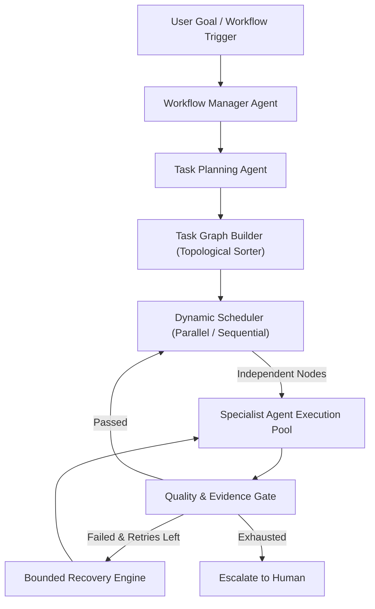

# Intelligent Autonomous Orchestration Model

## 1. Orchestration Engine Overview

The Orchestration Engine is the brain of Agentic Software Factory V3. It translates high-level engineering objectives into mathematically sound, dependency-aware task graphs and manages their distributed execution across specialist agents.

---

## 2. Dynamic Task Graph (DAG) Resolution

The engine represents workflows as a Directed Acyclic Graph:
$$G = (V, E)$$
where $V$ is the set of discrete tasks and $E$ is the set of directed dependency edges $(u, v)$ denoting that task $u$ must reach state `ACCEPTED` before task $v$ can transition to `READY`.

### Scheduling Algorithm:
1. **Topological Sort**: At initialization, the engine verifies acyclicity using Tarjan's or Kahn's algorithm. If a cycle is detected, graph compilation fails immediately with an error.
2. **Ready Queue Extraction**: All nodes $v \in V$ with in-degree 0 whose dependencies are satisfied are placed into the `READY` queue.
3. **Concurrency Analysis**:
   - For all candidate tasks in `READY`, compare their `allowed_paths` sets.
   - If $\text{allowed\_paths}(T_a) \cap \text{allowed\_paths}(T_b) = \emptyset$ and neither task modifies shared global state, dispatch $T_a$ and $T_b$ in parallel.
   - If an intersection exists, prioritize by task priority (`CRITICAL` > `HIGH` > `MEDIUM` > `LOW`) and execute sequentially.

---

## 3. Conflict Resolution Protocol

When specialist agents recommend conflicting technical directions (e.g., Database Architect prefers PostgreSQL relational schema while Backend Architect prefers document-oriented storage):
1. **Grounding in Requirements**: The dispute is evaluated against the non-functional requirements in the signed PRD (scalability, query complexity, ACID constraints).
2. **Architecture Precedence**: If unresolved, the **Principal Software Architect Agent** holds definitive decision authority.
3. **Formulation of ADR**: The chosen approach, alternative considered, and rationale are committed as a new Architecture Decision Record in `.agentic/memory/adrs/`.
4. **No Deadlock**: Unresolvable deadlocks automatically pause execution and present the specific trade-off to the human operator for decisive signoff.
