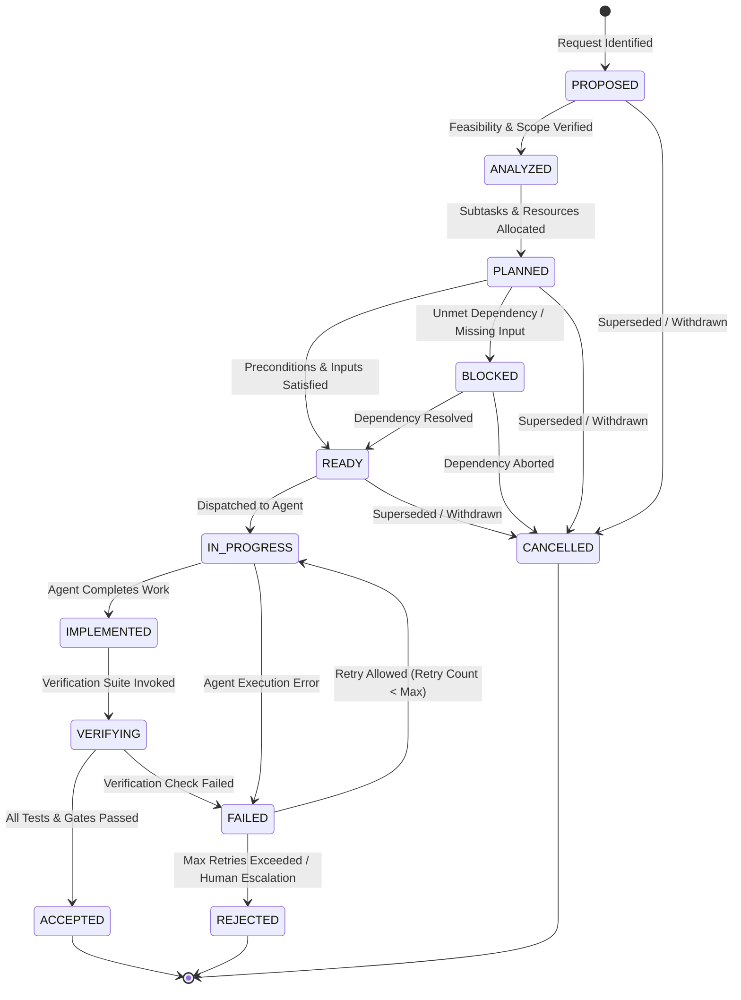

# Controlled Task State Machine Specification

## 1. State Machine Graph

The lifecycle of every task in Agentic Software Factory V3 is governed by a finite state machine enforced by `orchestration/state_machine.py`.

---

## 2. States & Transition Guards

| State | Purpose | Invariants & Preconditions | Postconditions / Deliverables |
|---|---|---|---|
| **`PROPOSED`** | Initial intake of the task from workflow or orchestrator. | Task has unique ID, objective, and description. | Queued for scope analysis. |
| **`ANALYZED`** | Feasibility, risks, and boundaries evaluated. | Assigned agent verified; allowed/forbidden paths set. | Clear inputs and acceptance criteria defined. |
| **`PLANNED`** | Placed in the dependency DAG with predecessor links. | Predecessors identified; priority assigned. | Task graph entry populated. |
| **`READY`** | All prerequisite tasks in DAG are `ACCEPTED`. | Input artifacts exist and are readable on disk. | Eligible for immediate worker dispatch. |
| **`IN_PROGRESS`** | Active execution by assigned specialist agent. | Agent lock acquired on task write scope. | Working diffs generated. |
| **`IMPLEMENTED`** | Code/artifact generation finished by agent. | Output artifacts exist at specified paths. | Handed off to verification suite. |
| **`VERIFYING`** | Automated tests, linters, and quality gates running. | Verification commands specified and executable. | Evidence logs captured. |
| **`ACCEPTED`** | Task proven complete and correct with verifiable evidence. | 100% acceptance criteria met; zero blocking gate failures. | Deliverables committed; unblocks dependents. |
| **`BLOCKED`** | Execution suspended due to missing input or external dependency. | Specific blocking condition documented in task notes. | Orchestrator notified. |
| **`FAILED`** | Agent crashed or verification failed. | Stack trace / failure log recorded. Triggers bounded recovery. | Retry count incremented. |
| **`REJECTED`** | Retry budget exhausted or safety violation detected. | Detailed post-mortem logged; requires human escalation. | Execution halted or task marked fatal. |
| **`CANCELLED`** | Task rendered obsolete by architectural change or user request. | Reason documented in handoff notes. | Dependent tasks notified. |

---

## 3. Bounded Error Recovery Rules

When a task transitions to `FAILED`:
1. **Failure Capture**: Capture stderr, test output summary, and affected file list.
2. **Root Cause Analysis**: The assigned agent or `technical-research` agent performs AST / stack trace parsing.
3. **Retry Counter Check**: If `retry_count < max_retries` (default: 3):
   - Increment `retry_count`.
   - Apply scoped patch or alternative algorithm.
   - Transition task back to `IN_PROGRESS` -> `IMPLEMENTED` -> `VERIFYING`.
4. **Escalation**: If `retry_count >= max_retries`:
   - Transition to `REJECTED`.
   - Log critical alert in `.agentic/logs/escalations.log`.
   - Halt affected pipeline branch and request human operator intervention.
   - **No infinite retry loops are ever permitted.**
