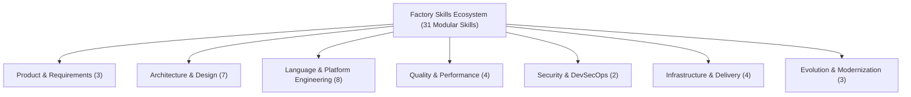

# Engineering Knowledge and Skill Ecosystem — Skills Catalogue (V4)

Agentic Software Factory V4 equips specialist agents with 31 modular, independently reusable skills. Each skill is packaged in a strictly flat directory (`.agentic/skills/<skill-name>/SKILL.md`) without nested subdirectories.

---

## Skill Taxonomy by Engineering Domain

---

## Catalogue Table

| Skill ID | Name | Category | Primary Focus |
|---|---|---|---|
| `requirements-engineering` | Requirements Engineering | Product | User stories, INVEST criteria, acceptance criteria |
| `prd-engineering` | PRD Engineering | Product | Product Requirements Documents, schema validation |
| `trd-engineering` | TRD Engineering | Product | Technical Requirements, 100% PRD traceability |
| `graphic-design` | Graphic Design | Architecture | Logo design, application icons, visual identity, Stitch/Figma MCP |
| `design-system-engineering` | Design System Engineering | Architecture | Complete UI/UX Design System, tokens, screens via Stitch/Figma MCP |
| `software-architecture` | Software Architecture | Architecture | System boundaries, trade-offs, ADR authoring |
| `clean-architecture` | Clean Architecture | Architecture | Layer isolation, dependency rule, ports & adapters |
| `domain-driven-design` | Domain-Driven Design | Architecture | Ubiquitous language, bounded contexts, aggregates |
| `solid-principles` | SOLID Principles | Architecture | Single responsibility, open/closed, Liskov, DIP |
| `database-architecture` | Database Architecture | Architecture | Relational & NoSQL modeling, migrations, indexing |
| `api-engineering` | API Engineering | Architecture | RESTful, GraphQL, OpenAPI 3.0, RFC 7807 errors |
| `flutter-dart` | Flutter & Dart | Development | Cross-platform mobile, reactive state, platform channels in `app/` |
| `laravel-php` | Laravel & PHP | Development | Eloquent ORM, service container, Artisan, Pest in `app/` |
| `react-typescript` | React & TypeScript | Development | React 18+, hooks, strict TypeScript, component libraries in `app/` |
| `nodejs-typescript` | Node.js & TypeScript | Development | Asynchronous microservices, Fastify, Express, Jest in `app/` |
| `python-engineering` | Python Engineering | Development | Modern Python 3.10+, FastAPI, mypy strict, pytest in `app/` |
| `java-engineering` | Java Engineering | Development | Spring Boot 3, JPA/Hibernate, Gradle, Testcontainers in `app/` |
| `csharp-dotnet` | C# and .NET | Development | .NET 8+, ASP.NET Core, EF Core, xUnit, Polly in `app/` |
| `mobile-engineering` | Mobile Engineering | Architecture | Offline-first, lifecycle, memory, keystore security |
| `web-engineering` | Web Engineering | Architecture | Core Web Vitals, SSR/SSG, caching, responsive design |
| `desktop-engineering` | Desktop Engineering | Architecture | Tauri, Electron, native IPC, packaging, window lifecycle |
| `testing-qa` | Testing and QA | Quality | Testing pyramid, TDD, mocks, contract & mutation tests |
| `application-security` | Application Security | Security | OWASP Top 10, input sanitization, crypto standards |
| `devsecops` | DevSecOps | Infrastructure | SAST, SCA, container scanning, secret detection |
| `cloud-engineering` | Cloud Engineering | Infrastructure | Cloud topologies, Terraform IaC, Well-Architected |
| `cicd-engineering` | CI/CD Engineering | Infrastructure | GitHub Actions, pipeline caching, matrix builds |
| `performance-optimization` | Performance Optimization | Quality | Profiling, flame graphs, database EXPLAIN, caching |
| `accessibility-engineering` | Accessibility Engineering | Quality | WCAG 2.1 AA/AAA, ARIA attributes, keyboard traversal |
| `software-migration` | Software Migration | Architecture | Strangler Fig, runtime upgrades, expand-contract |
| `legacy-modernization` | Legacy Modernization | Architecture | Characterization tests, seams, debt reduction |
| `documentation-engineering` | Documentation Engineering | Infrastructure | Diátaxis framework, Mermaid diagrams, markdown in `docs/` |
