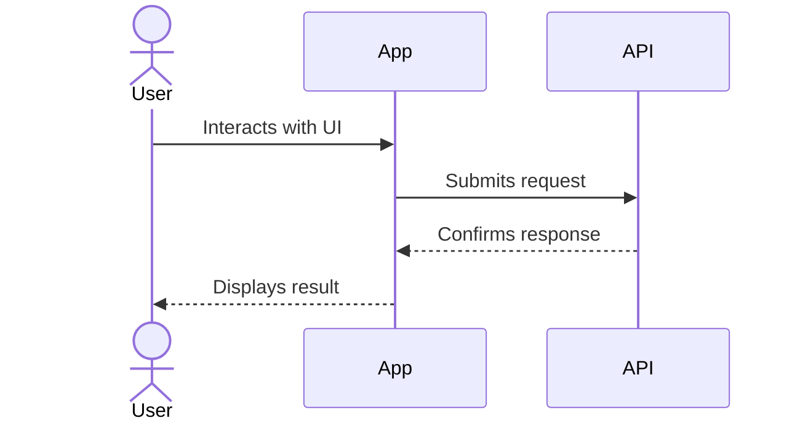

# Product Requirements Document: [Project Name]

- **Document ID**: PRD-001
- **Version**: 1.0.0
- **Status**: DRAFT | UNDER_REVIEW | APPROVED
- **Date**: YYYY-MM-DD
- **Author**: prd-architect

---

## 1. Executive Summary
Brief high-level overview of the product, problem space, and intended outcome.

## 2. Problem Statement & Market Opportunity
- Clear explanation of the current pain points.
- Why solving this problem matters now.

## 3. Target Audience & Personas
### Persona 1: [Name / Role]
- **Goals**: ...
- **Pain Points**: ...

## 4. Functional Requirements
| Req ID | Title | Description | Priority (MoSCoW) | Acceptance Criteria (Given-When-Then) |
|---|---|---|---|---|
| REQ-F-001 | User Authentication | Secure email and OAuth login | MUST_HAVE | Given valid credentials, when submitted, then user is authenticated. |

## 5. Non-Functional Requirements
| Category | Specification | Metric | Target SLA |
|---|---|---|---|
| PERFORMANCE | Endpoint Latency | p95 Latency | < 200ms |
| SECURITY | Data Protection | Encryption | AES-256-GCM at rest, TLS 1.3 in transit |
| ACCESSIBILITY | Accessibility Standard | WCAG 2.1 | Level AA Compliance |

## 6. User Journeys

## 7. Out of Scope
- Explicit list of features deliberately deferred to future versions.

## 8. Success Metrics & KPIs
- North Star metric and adoption targets.

## 9. Signoff
- **Approved by**: [Stakeholder / Agent]
- **Date**: YYYY-MM-DD
- **Evidence**: [Hash / Link]
