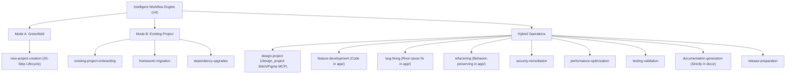

# Intelligent Workflow Engine — Workflows Catalogue (V4)

Agentic Software Factory V4 features an intelligent, declarative workflow engine with 13 canonical execution pipelines tailored for Greenfield (Mode A), Existing Project (Mode B), and Specialized UI/UX Design operations.

---

## Workflow Matrix

---

## Catalogue Table

| Workflow ID | Name | Operating Mode | Stages | Quality Gates | Primary Focus |
|---|---|---|---|---|---|
| `design-project` | Autonomous UI/UX & Visual Design | HYBRID | 6 | GATE 1, 2 | 100% Stitch/Figma MCP mockups, Design System, logos, icons in `docs/` |
| `new-project-creation` | New Project Creation | GREENFIELD | 18 | GATE 1, 2, 3, 4, 5 | Complete 20-stage product lifecycle (Code in `app/`, design in `docs/`) |
| `existing-project-onboarding` | Existing Project Onboarding | EXISTING_PROJECT | 6 | Baseline Scan | Discovery, profiling, AST scan, user diff protection |
| `feature-development` | Targeted Feature Development | HYBRID | 5 | GATE 3 (Code) | Scoped capability addition strictly inside `app/` |
| `bug-fixing` | Autonomous Root-Cause Bug Fixing | HYBRID | 4 | GATE 3 (Code) | Failing test -> Root cause fix in `app/` -> Green test -> Lesson record |
| `refactoring` | Behavior-Preserving Refactoring | HYBRID | 4 | GATE 3 (Code) | Characterization tests -> Micro-refactor in `app/` -> Structural review |
| `framework-migration` | Framework & Runtime Migration | EXISTING_PROJECT | 4 | GATE 3 (Code) | Breaking change scan -> Strangler Fig -> Module upgrade in `app/` |
| `dependency-upgrades` | Automated Dependency Upgrades | EXISTING_PROJECT | 3 | GATE 3 (Code) | Vulnerability scan -> Lockfile regen -> Build test check in `app/` |
| `security-remediation` | Security Remediation | HYBRID | 3 | GATE 4 (Security) | Triage findings -> Patch vulnerability in `app/` -> SAST rescan |
| `performance-optimization` | Performance Optimization | HYBRID | 3 | GATE 3 (Code) | Baseline profile -> Targeted optimization in `app/` -> SLA re-check |
| `testing-validation` | Holistic Test Validation | HYBRID | 5 | GATE 3 (Code) | Unit, integration, a11y, and E2E test certification |
| `documentation-generation` | Continuous Documentation | HYBRID | 3 | Lint & Link Check | OpenAPI docs, developer guide, markdown strictly in `docs/` |
| `release-preparation` | Release Packaging & Delivery | HYBRID | 4 | GATE 5 (Release) | Gate verification, SemVer, CHANGELOG, human approval |
